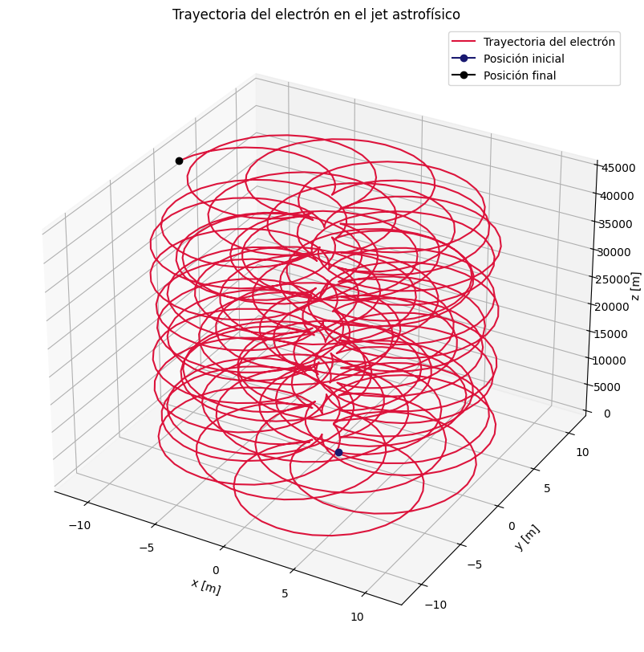
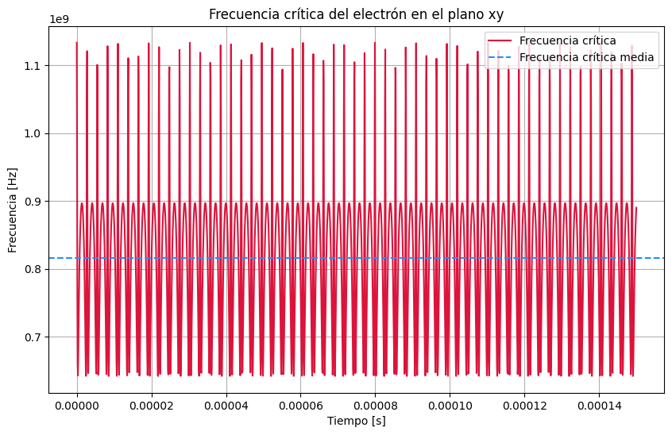
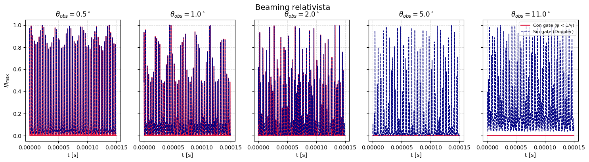

# Relativistic Motion and Synchrotron Radiation in Astrophysical Jets

**Numerical astrophysics | Universidad de Antioquia | 2025**  
**Author:** Manuela Marín Gómez  
**Context:** Individual computational project for *Celestial Mechanics*, taught by Prof. Jorge I. Zuluaga.

> **Portfolio version — under review.** This repository is adapted from my 2025 course notebook. The original numerical workflow is preserved, but some physical approximations and numerical diagnostics still need independent verification; see [`REVIEW_NOTES.md`](REVIEW_NOTES.md).

## Overview

How does an electron move through a helical magnetic field inside an astrophysical jet, and how do relativistic effects influence the radiation observed? This notebook numerically integrates the motion of a relativistic electron, tests properties of its four-velocity and four-acceleration, estimates characteristic synchrotron frequencies, and explores Doppler boosting and simplified beaming light curves.

This is an **idealized single-particle model**, not a full magnetohydrodynamic jet simulation or a population-level synchrotron spectrum.

## Scientific background

### 1. Helical magnetic field

The jet axis lies along $z$, with zero electric field in the chosen frame. A poloidal and a toroidal component give

$$
\mathbf{B}(r)=B_0\hat{\mathbf e}_z+\frac{B_1}{r}\hat{\mathbf e}_\phi,
\qquad r=\sqrt{x^2+y^2}.
$$

In Cartesian coordinates,

$$
\mathbf{B}(x,y)=\left(-\frac{B_1 y}{x^2+y^2},\;\frac{B_1 x}{x^2+y^2},\;B_0\right).
$$

The notebook applies a small-radius cutoff in the numerical denominator to avoid divergence at $r=0$; this is a **numerical regularization**, not a physical model of the jet core.

### 2. Relativistic motion

With $\mathbf{E}=0$, the Lorentz force is written in terms of the spatial part of the four-velocity, $\mathbf{u}=\gamma\mathbf v$:

$$
\frac{d\mathbf r}{d\tau}=\mathbf u,\qquad
\frac{d\mathbf u}{d\tau}=\frac{q}{m_e}\left(\mathbf u\times\mathbf B\right),
\qquad \frac{dt}{d\tau}=\gamma=\sqrt{1+\frac{\lVert\mathbf u\rVert^2}{c^2}}.
$$

Here $\tau$ is proper time, $q=-e$ is the electron charge, and $\gamma=(1-v^2/c^2)^{-1/2}$. The notebook integrates this first-order system using `scipy.integrate.solve_ivp`.

A consistency check is that magnetic fields do no work: in this model the Lorentz factor is constant. In four-vector notation the four-velocity $U^\mu$ and four-acceleration $A^\mu$ satisfy

$$U^\mu A_\mu=0,\qquad U^\mu U_\mu=c^2.$$

### 3. Characteristic synchrotron frequencies

The relativistic gyrofrequency in a locally uniform magnetic field is

$$
 f_{\rm gyr}=\frac{|q|B}{2\pi\gamma m_e}.
$$

For the pitch-angle-dependent perpendicular field $B_\perp$, the critical synchrotron frequency is estimated as

$$
 f_{\rm c}=\frac{3|q|B_\perp\gamma^2}{4\pi m_e},\qquad
 f_{\rm peak}\approx0.29f_{\rm c}.
$$

These are characteristic-frequency estimates. The notebook does not numerically solve the full radiative transfer problem or evolve radiation-reaction losses.

### 4. Doppler boosting and beaming

For a line-of-sight unit vector $\hat{\mathbf n}$, the Doppler factor is

$$
\delta=\frac{1}{\gamma(1-\boldsymbol\beta\cdot\hat{\mathbf n})},\qquad
\boldsymbol\beta=\frac{\mathbf v}{c}.
$$

The notebook uses $I_{\nu}\propto\delta^3$ as a **simplified** intensity prescription and also compares with an optional geometric gate based on an emission-cone scale $\theta\sim1/\gamma$. Such a hard gate is an illustrative approximation, not a full synchrotron angular emissivity model. The Doppler exponent depends on the observable and spectral assumptions.

## Selected figures

The figures below are extracted from notebook outputs and **have not been independently revalidated**.

*Electron trajectory in the prescribed magnetic field.*

*Model estimate of the critical synchrotron frequency along the trajectory.*

*Normalized beaming-light-curve comparison for different viewing angles in a simplified prescription.*

## Repository structure

- `notebooks/jets_astrophysical.ipynb` — cleaned portfolio copy of the original computational solution.
- `figures/` — figures extracted from the user's executed notebook.
- `docs/theory_es.md` — short physics explanation in Spanish.
- `REVIEW_NOTES.md` — numerical and physical issues to verify before publishing as a validated result.

## How to run

1. Create a Python environment and install the packages in `requirements.txt`.
2. Open `notebooks/jets_astrophysical.ipynb` in Jupyter or Google Colab.
3. Run the cells in order. The notebook retains its original `pymcel` installation cell.

**Execution status:** this packaging step did not execute or independently reproduce the notebook. Package versions and reproducibility should be checked before public release.

## Acknowledgments and attribution

Developed as an individual coursework project in *Celestial Mechanics* at Universidad de Antioquia (instructor: Prof. Jorge I. Zuluaga). The professor's assignment text and the student's personal identification number are intentionally excluded from this repository. The scientific interpretations are the student's project work; the repository README is a later explanatory summary. Please cite or acknowledge any additional materials used when extending the project.
